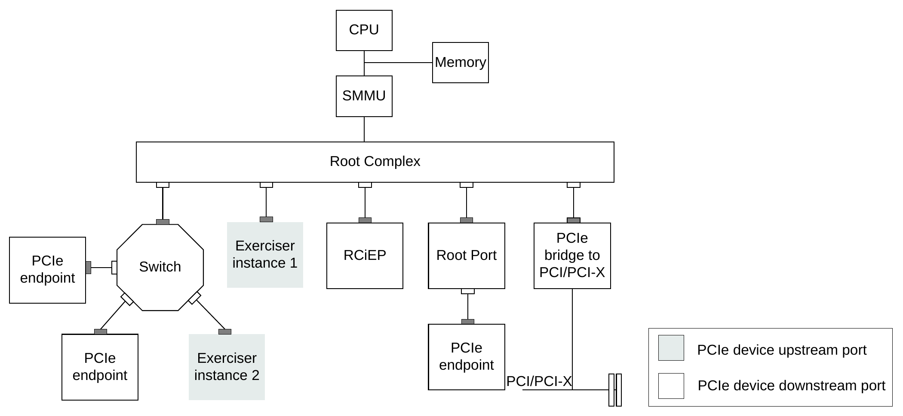

=====================================
RME System ACS Validation Methodology
=====================================

.. contents:: Contents
   :depth: 2

Validation Scope
================

RME System Architecture Compliance Suite (ACS) checks selected observable
behaviors required by the RME System Architecture. The tests are portable
across platforms through the Validation Abstraction Layer (VAL) and Platform
Abstraction Layer (PAL).

ACS coverage is not exhaustive and is not a substitute for design verification.
For the rules covered by each test and their algorithms, see the
`Scenario Document <Arm_RME_System_Architecture_Compliance_Suite_Scenario_Document.rst>`_.
The `Platform Porting Guide <Arm_RME_System_ACS_Platform_porting_guide.rst>`_
describes platform integration.

Test Suites and Coverage
------------------------

Tests are grouped by the area being exercised, not by a particular model or
platform. The current source groups are:

.. list-table:: Test suites
   :header-rows: 1
   :widths: 20 80

   * - Directory under ``test_pool/``
     - Validation areas
   * - ``rme/``
     - PAS filtering, GPC, encryption, cache maintenance, reset, and PE state.
   * - ``smmu/`` and ``gic/``
     - RME support in the SMMU and GPC enforcement for SMMU and ITS accesses.
   * - ``legacy_system/``
     - LEGACY_TZ support, configuration, and reset behavior.
   * - ``da/``
     - Device Assignment, IDE, TDISP controls, protected registers, and
       device-to-host or peer-to-peer traffic.
   * - ``dpt/``
     - Device Permission Table enforcement for system resources and
       peer-to-peer access.
   * - ``mec/``
     - MEC support, MECID association, encryption, and cache maintenance.
   * - ``cxl/``
     - Coherent host-port controls, HDM decoding, IDE, CXL-TSP, PAS/CKID
       mapping, and memory expansion.
   * - ``cda/``
     - Coherent Device Assignment, TDI lifecycle, DCM protection, coherent
       traffic, and host enforcement.
   * - ``tdisp/``
     - Arm TDISP vendor-defined message formats and semantics, including
       GET_VERSION, GET_DEV_PROP, SET_INTERFACE, and error responses.

The `test dispatcher <../val/src/val_test_infra.c>`_ identifies executable
tests; the `Scenario Document`_ gives their rule mapping, algorithms,
applicability, and coverage limits. A registered test or a successful run on
one endpoint does not establish complete coverage of every clause of a rule.
Device-local checks and exerciser observations must be distinguished from
evidence of host-port or system enforcement.

Software Layers
===============

The test software uses the following layers:

.. list-table:: Compliance test layers
   :header-rows: 1
   :widths: 20 80

   * - Layer
     - Responsibility
   * - ``test_pool``
     - Targeted compliance tests. Tests use the interfaces provided by VAL.
   * - VAL
     - A uniform view of hardware and test infrastructure for the test suite.
   * - PAL
     - Platform-specific implementations of Arm-defined C interfaces. PAL
       abstracts differences between systems and their execution environments.

The platform may provide UEFI or OS services, or a bare-metal implementation:

.. code-block:: text

   RME ACS tests
        |
        v
       VAL
        |
        v
       PAL
        |
        +--------------------------+
        |                          |
        v                          v
     UEFI / OS                 Bare-metal
        |                          |
        +-- Trusted firmware       |
        +-- Non-secure MMIO        |
        +-- ACPI tables            |
        |                          |
        +------------+-------------+
                     |
                     v
              RME-enabled hardware

The hardware includes PEs, GIC, watchdogs, timers, SMMUs, PCIe, memory, RAS,
MPAM, PMU, wakeup facilities, and peripherals.

In the UEFI flow, the application wrapper invokes the test suite, which uses
the VAL and PAL libraries:

.. code-block:: text

   UEFI application wrapper -> Test suite -> VAL library -> PAL library

Test and Infrastructure Guidelines
----------------------------------

- Tests call VAL APIs.
- VAL calls PAL where the requested functionality needs platform support.
- Tests do not call PAL functions directly.
- Porting to another platform does not require changes to the test layer.
- Platform-specific porting changes belong in PAL.
- Architectural changes affecting multiple platforms may require VAL changes.
- Reuse common helpers in the module that owns the operation: for example,
  memory mapping in ``val_memory.c``, ATS enablement in ``val_pcie.c``, and
  CDA-specific orchestration in ``val_cda.c``.
- Treat exerciser controls as stimulus or observation mechanisms. They must
  not manufacture the compliance result or replace the host path under test.

Exerciser
=========

An exerciser is a programmable PCIe endpoint that generates custom stimuli for
testing PCIe integration into an Arm SoC. Its capabilities can include I/O
coherency, snooping, address translation, PASID transactions, DMA, MSI, and
legacy interrupts.

Example Placement
-----------------

An exerciser can be integrated into the Root Complex or connected downstream
as an endpoint. A hierarchy may include multiple exercisers:

         Root Complex. Exerciser instance 1 is an RCiEP. The legend distinguishes
         upstream and downstream ports.
   :width: 100%

   Exerciser in an SoC (Figure 1-3 from the original methodology).

Exerciser instance 1 connects directly to the Root Complex as an RCiEP.
Exerciser instance 2 connects through a downstream port of the switch, as do
the two PCIe endpoints shown on the left. The figure retains the upstream and
downstream port markings from the original diagram.

The number and placement of exercisers are platform-specific. Multiple
exercisers provide greater coverage of the system's PCIe hierarchy.

Hardware and Software Interfaces
--------------------------------

The exerciser must provide a way to configure transaction and interrupt
attributes, trigger operations, and obtain their status. The mechanism is
implementation-defined. The reference interface uses PCIe configuration space
and BAR-mapped registers:

.. code-block:: text

   Exerciser interface
    +-- PCIe configuration space
    +-- BAR-mapped control and status registers
         +-- Memory transaction generator
         +-- Interrupt generator

The software path is:

.. code-block:: text

   Exerciser tests (MSI, DMA, coherency)
                    |
                   VAL
                    |
                   PAL
                    |
          +---------+----------+
          |                    |
     UEFI / MMIO         Exerciser controls
          |                    |
     Configuration       Transaction and
        space          interrupt generators

Configuration-space accesses can use UEFI or MMIO services. Transaction and
interrupt generation use exerciser PAL APIs. The non-secure PCIe flow is one
use of this interface; the supported RME stimuli and their PAS controls are
described in the `Exerciser Requirements <Exerciser.md>`_ and the
`Exerciser API Porting Guide <Exerciser_API_porting_guide.md>`_.

Coherent Exerciser Support
--------------------------

CHI-C2C capability does not by itself identify an exerciser. Tests that need
programmable DMA, cache state, or snoops select an endpoint recognized by
``pal_is_bdf_exerciser`` as well as checking its coherent capabilities.
The BDF-based VAL interfaces address that exact endpoint. Protocol-only tests
can use ordinary coherent devices when their required interfaces are present.

The current CDA stimuli include ATS request attributes and ATC-backed DMA,
Realm DCM assignment, cache-line preparation and writeback, device-to-host
snoops, snoop-response MECID selection, and incoming transaction capture.
These capabilities are implementation-defined exerciser facilities, not a
mandatory register layout for a compliant host port. A PAL port translates the
logical operations into its exerciser's interface and reports unsupported
operations rather than returning fabricated success.

Address Domains
~~~~~~~~~~~~~~~

.. list-table:: Addresses used by the tests
   :header-rows: 1
   :widths: 25 75

   * - Address
     - Use
   * - VA
     - A PE-visible virtual address. EL3 mappings must exist for every page
       accessed by an EL3 helper, including DMA source and destination pages.
   * - IOVA
     - The input to SMMU translation or ATS. ATC-backed DMA uses the original
       IOVA so the exerciser looks up the previously obtained translation.
   * - HPA
     - The host physical address for coherent DCM traffic and host mappings.
       DCM assignment, dirty-line, writeback, and snoop commands identify their
       target using this address in the current interface.
   * - DPA
     - The device physical address used only by direct-media backdoor reads
       and writes. These operations initialize or inspect media independently
       of the normal coherent access being checked.

``val_cxl_hpa_to_dpa`` derives a DPA from the endpoint's committed HDM decoders,
including supported interleave settings, preceding decoder allocations, and
DPA Skip. Do not assume that a DPA equals the HPA or a fixed offset from a
model-specific base. A platform without a usable decoder mapping or equivalent
media-observation mechanism cannot supply this observation for the test.

Backdoor success is not evidence that a host or device access was permitted.
The transaction under test must still use its normal IOVA/HPA path.

Execution Flow
==============

The execution environment invokes the application entry point. The suite then
iterates through the selected tests, reports results, and exits when testing
is complete. Individual tests may require a reboot or a sleep transition.

.. code-block:: text

   Test suite entry
          |
          v
     Start next test <-------------------+
          |                             |
          v                             |
     Execute test                       |
     (reset or sleep when required)     |
          |                             |
          v                             |
     Report status                      |
          |                             |
          v                             |
     More tests? ---- Yes --------------+
          |
          No
          |
          v
     Test suite exit

Registration and Results
------------------------

A test's entry function initializes its name, description, rule identifier,
and PE count, invokes its payload, and reports the final status. To add a test:

1. Add the source under its ``test_pool/<suite>/`` directory and declare the
   entry point in the corresponding VAL header.
2. Add the module entry identifier in `val_common.h <../val/include/val_common.h>`_
   and register the entry function and test name in the `test dispatcher`_.
3. Add the source to `RmeAcs.inf <../uefi_app/RmeAcs.inf>`_ for UEFI builds.
   Bare-metal `test.cmake <../test_pool/test.cmake>`_ discovers test sources;
   rerun CMake configuration after adding files.
4. Add the rule's algorithm and applicability to the `Scenario Document`_.
   Keep dependent tests after the entries whose results they consume.

The dispatcher records both execution and result status. Tests excluded by
selection have no passing result; ``val_get_module_test_result`` returns
``ACS_STATUS_SKIP`` for an unexecuted entry. It does not run the prerequisite.

.. list-table:: Reported outcomes
   :header-rows: 1
   :widths: 25 75

   * - Outcome
     - Interpretation
   * - PASS
     - The implemented checks completed under the test's applicability and
       endpoint aggregation policy.
   * - FAIL
     - A checked expectation failed, or the test reported an operational or
       cleanup failure. Diagnostics are needed to distinguish these causes.
   * - SKIPPED
     - Required applicability, setup, stimulus, or observation was unavailable,
       or a dependent test had not run. This does not establish compliance.
   * - PASSED PARTIAL
     - An explicitly defined subset passed, but another required observation
       was unavailable. Only tests with an explicit partial-coverage policy
       produce this result.

``val_check_for_error`` returns ``ACS_STATUS_PASS`` for both PASS and
PASSED PARTIAL and increments the passed-test count for either. Preserve the
per-test result text when assessing coverage; a summary count alone loses
this distinction.

RNSMGT uses the recorded results of RSHSXK and RJSYPS without additional
hardware stimulus. Both passing gives PASS; one passing and one skipped gives
PASSED PARTIAL; both skipped gives SKIPPED; any other combination gives FAIL.
Select both prerequisites when requesting full dependent coverage.

RDRVTK can report partial coverage when the device-to-host request MECID check
passes but the snoop-response stimulus is unavailable. RNVWMC does not use
partial pass: it requires at least one completed endpoint and no failed or
skipped applicable endpoints; unresolved host discovery also prevents PASS.

Source Layout
-------------

.. list-table:: Source directories
   :header-rows: 1
   :widths: 30 70

   * - Directory
     - Contents
   * - ``Docs/``
     - Documentation.
   * - ``baremetal_app/``
     - Bare-metal application that invokes the test entry points.
   * - ``ext/``
     - External dependencies, including libspdm, spdm-emu, and their headers.
   * - ``prebuilt_images/``
     - Prebuilt binaries and platform configuration files.
   * - ``pal_el3/``
     - Platform abstraction for the EL3 validation code.
   * - ``platform/pal_baremetal/``
     - Bare-metal PAL reference implementation.
   * - ``platform/pal_uefi/``
     - UEFI PAL reference implementation.
   * - ``test_pool/``
     - Test cases grouped by suite.
   * - ``tools/``
     - Build and stack scripts, platform configurations, and SysARCUI.
   * - ``uefi_app/``
     - UEFI application that invokes the test entry points.
   * - ``val/``
     - Shared test infrastructure, with calls to PAL where needed.
   * - ``val_el3/``
     - Shared EL3 validation code, with calls to EL3 PAL where needed.

Platform Inputs and Builds
--------------------------

Provide the platform's EL3 configuration in
``pal_el3/<platform>/include/pal_el3_config.h``. Runtime configuration is
provided through ``prebuilt_images/<platform>_config.ini``; the Base RevC and
RD-V3 files are examples. Platforms not using ``Parser.efi`` must provide the
corresponding PAL platform override configuration.

Use the `repository README <../README.md>`_ for ACS build and execution steps,
and the `stack scripts guide <../tools/scripts/README.md>`_ for software-stack
setup. EL3 integration and build steps are in the
`EL3 README <../val_el3/README.md>`_.

For the supported reference stacks, ``tools/scripts/acsstack.sh`` manages
stack setup, platform patches, builds, and model launch. ``FVP_BASE_MODEL``
selects an alternate Base RevC model binary. Platform configuration must still
describe the selected system's ECAM, SMMUs, coherent host bridges, memory
windows, and endpoint capabilities; changing the binary alone does not update
those inputs.

Tests requiring SPDM/TDISP or CXL-TSP need the corresponding requester support
built with ``ENABLE_SPDM`` and a usable management transport. Disabling it
leaves affected tests with a prerequisite skip, not protocol coverage.

EL3 Firmware Integration
========================

The software stack must include EL3 firmware with an ACS SMC handler. Trusted
Firmware-A (TF-A) provides a reference EL3 Secure Monitor implementation.
An SMC from Non-secure EL2 using the ACS service identifier must be dispatched
to the ACS handler. Use the handler and SMC identifier documented in the
`EL3 README`_ for the selected software stack.

The firmware dispatcher, ACS application, and EL3 support must agree on
``ARM_ACS_SMC_FID`` and the service ABI in
`val_interface.h <../val/include/val_interface.h>`_ and
`val_el32.h <../val/include/val_el32.h>`_. Rebuild and repackage the firmware
when that ABI changes; replacing only the UEFI application cannot update an
older BL31 handler. Shared-memory and buffer addresses must retain their full
64-bit width across the SMC boundary.

Module setup initializes Realm SMMU support before CDA tests that need Realm
translations. Running only CDA must not depend on an earlier DA or MEC suite
having initialized it. ``SKIP_SMMU_GIC_ITS_INIT`` deliberately bypasses SMMU
initialization and must not be used when validating paths that require it.

Memory Prerequisites
--------------------

The reference integration requires the following memory resources:

.. list-table:: EL3 and test memory
   :header-rows: 1
   :widths: 30 70

   * - Resource
     - Requirement
   * - EL2/EL3 shared memory
     - A 4 KB, 16 KB, or 64 KB shared region for test requests, results, and
       context exchanged between the two exception levels.
   * - Root memory
     - A 2 MB flat-mapped Root PAS region for EL3 MMU tables and ``SP_EL3``.
   * - Realm memory
     - A flat-mapped Realm PAS region starting at ``PLAT_FREE_MEM_SMMU`` for
       Realm SMMU and page tables. Size ``PLAT_MEMORY_POOL_SIZE`` for
       ``PLATFORM_OVERRIDE_SMMU_STRTAB_BITS`` and additional EL3 allocations;
       a fixed 2 MB allocation is not sufficient for every configuration.
   * - Test physical memory
     - A 2 MB free physical-address region reserved for tests.
   * - Test virtual addresses
     - A 512 MB unused virtual-address range within the 48-bit address space.
   * - Non-volatile memory
     - A 4 KB region used to preserve state across reset tests.

EL3 Components
--------------

The EL3 validation implementation is under ``val_el3/``:

.. list-table:: EL3 validation components
   :header-rows: 1
   :widths: 30 70

   * - Component
     - Files
   * - SMC dispatcher
     - ``src/val_el3_plat_smc_handler.c``
   * - Exception and ACK handling
     - ``src/val_el3_exception.c``, ``include/val_el3_exception.h``
   * - MMU and GPT helpers
     - ``src/val_el3_pgt.c``, ``include/val_el3_pgt.h``
   * - Shared memory and allocator
     - ``src/val_el3_memory.c``, ``include/val_el3_memory.h``
   * - Security helpers
     - ``src/val_el3_security.c``, ``include/val_el3_security.h``
   * - SMMU helpers
     - ``src/val_el3_smmu.c``, ``include/val_el3_smmu.h``
   * - MEC helpers
     - ``src/val_el3_mec.c``, ``include/val_el3_mec.h``
   * - PE and system-register helpers
     - ``src/val_el3_pe.c``, ``include/val_el3_pe.h``
   * - Root watchdog helpers
     - ``src/val_el3_wd.c``, ``include/val_el3_wd.h``
   * - Debug and logging wrappers
     - ``include/val_el3_debug.h``

The corresponding platform code is under ``pal_el3/<platform>/``:

- ``include/pal_el3.h`` declares the PAL interfaces.
- ``include/pal_el3_config.h`` defines the platform configuration.
- ``src/pal_el3.c`` implements platform functions or reference stubs.
- ``include/pal_el3_print.h`` provides the logging backend.

CDA Validation Methodology
==========================

Coverage Areas
--------------

The following groups summarize the registered CDA scenarios. They describe
the implemented checks, not a claim of exhaustive rule coverage. Test sources
are under `test_pool/cda <../test_pool/cda/>`_; detailed steps and restrictions
remain in the `Scenario Document`_.

.. list-table:: CDA coverage groups
   :header-rows: 1
   :widths: 30 70

   * - Rules
     - Implemented scenario
   * - RSHRMN
     - Coherent-link topology and endpoint placement.
   * - RYDSYL, RDMSPT
     - Device-to-host security attribution and RID range enforcement,
       observed through accepted or rejected DMA.
   * - RKRCWK, RSHSXK
     - Host GPC for PE accesses to DCM and GPC/DPT enforcement for
       device-to-host accesses to host memory.
   * - RQRMSC, RYJVJR
     - ATS dependency for DCM without device-side PAS checking, and ATS TE
       reflecting the translated output PAS.
   * - RFZBMW, RWWBPM, RVHZCR
     - External and internal DCM access conditions, TDI RUN/IDE gating,
       and device-side PAS protection.
   * - RWFYLW
     - Protection of HDM decoder configuration and DSM-reported state
       across interface locking.
   * - RJZQCP, RLMFLX, RHDXTM
     - Reset-related protected state, cache/ATC invalidation on unlock,
       and scrubbing of TDI-associated DCM.
   * - RQWNBN, RHTTNB
     - Poisoned responses for ERROR-state cached Realm data and blocked
       snoops to dirty TDI-associated data.
   * - RFRFJG, RJSYPS
     - Device snoop permission checks and host enforcement of the attached
       device's DCM range for device-to-host snoops.
   * - RSTQHS, RVPKVF
     - Host forwarding observations and coherent-operation availability
       across TDI state changes. See the monitoring limitations below.
   * - RNSMGT
     - Dependent host DCM-range coverage from RSHSXK and RJSYPS.
   * - RDRVTK
     - SMMU-selected request MECID and, when supported, rejection or
       isolation of unpermitted snoop-response MECIDs.
   * - RNVWMC
     - Measurement retrieval and TDI assignment interface operation over
       SPDM, including interface report and lifecycle checks.

Discovery and Applicability
---------------------------

Use the CXL information and component tables to associate an endpoint with
its upstream coherent host port, CFMWS windows, and HDM decoders. Check the
RME-CDA DVSEC and the capabilities needed by the individual scenario.
``val_cda_find_downstream_chi_c2c_endpoint`` permits an ordinary endpoint;
``val_cda_find_downstream_chi_c2c_exerciser_endpoint`` additionally requires
a programmable exerciser.

The current CDA assignment scenarios select CHI-C2C devices. CXL Type-1/2/3
classification alone does not make a native CXL device applicable to these
CHI scenarios. RNVWMC accepts all discovered CHI-C2C endpoint types, including
cache-only devices, without requiring CXL.mem or an exerciser. RHDXTM uses a
generic CHI-C2C endpoint with reported DCM ranges. Traffic and cache-stimulus
tests generally require an exerciser. Native CXL memory-expansion checks are
separate scenarios in ``test_pool/cxl/``.

Query TDISP device properties such as PAS_CHECK and MEC support before
choosing an access path. RQRMSC applies its ATS checks to PAS_CHECK==FALSE;
RWWBPM covers both PAS_CHECK modes. These are device properties, not reasons
to hard-code endpoint addresses or topology in a test.

Where a test searches multiple candidates, restore a skipped endpoint before
trying another. A missing stimulus on one endpoint is not evidence that every
endpoint lacks it. Follow the individual test's endpoint aggregation policy
when interpreting the final result.

Setup and Cleanup
-----------------

Use only quiesced devices and memory reserved for ACS. TDISP STOP, ERROR, and
reset flows can invalidate translations, scrub DCM, and discard protected
state; these tests must not run against an assigned production workload.

Depending on the scenario, preparation includes host/endpoint HDM decoding,
RID range programming, Realm SMMU mappings, GPT ownership, DPT permissions,
SPDM/TDISP state, and coherent-link IDE. Finish decoder configuration before
enabling controls that lock it. Read back protection state before treating
setup as successful.

GPT ownership, SMMU output PAS, device Realm assignment, and IDE are distinct
controls. A Realm PE mapping or GPT entry alone does not establish device-side
DCM assignment or a TDI RUN state. Negative cases must change the intended
condition while keeping other prerequisites valid.

Save changed configuration and track acquired resources. On every exit,
stop traffic and monitoring, restore relevant ATC/ATS and SEC_SID controls,
tear down ACS-created IDE and management sessions, and restore GPT, DPT,
SMMU, decoder, RID, cache-enable, and host control state as applicable.
Intentional ERROR cases may require endpoint reset and a fresh management
session to recover the link. Cleanup failures must not be hidden by an
earlier successful observation.

DMA and ATS Evidence
--------------------

For a DMA round trip, initialize an ACS-owned source buffer, transfer it to
the device with ``EDMA_TO_DEVICE``, transfer device data to a separate
destination with ``EDMA_FROM_DEVICE``, and compare source and destination.
Do not assume that an exerciser BAR exposes its internal DMA buffer. Map both
buffers in EL3 when EL3 initializes or compares them, and perform the required
cache maintenance for the selected coherency attributes.

For ATS-dependent DCM access, configure an IOVA-to-DCM-HPA mapping and use
``val_exerciser_ats_translate_by_bdf``. Its successful return means the
request/response interface was used successfully; the test must separately
check ``completion_success``, ``translated_pa``, ``te``, and permission bits
in ``VAL_ATS_TRANSLATION_RESULT``. A denied translation can therefore be an
expected response rather than a helper failure.

``val_exerciser_dma_with_atc_by_bdf`` enables ``TXN_ATC_ENTRY`` and submits the
original IOVA. This differs from simply marking a physical-address DMA as
``AT_TRANSLATED``. Request T/XT attributes are inputs to the ATS request;
they must not be changed to manufacture the expected TE response. RYJVJR
checks output PAS through SMMU mappings and the returned translation attributes.

RQRMSC uses three observations: rejection with an empty ATC, successful DCM
update after an ATS-derived translation, and denial after changing GPT/GPC
state and invalidating cached permissions. Direct DPA readback checks DCM
contents independently. This establishes the exercised flow, not the
provenance of every address an arbitrary device could issue.

RWWBPM uses ATS-backed DMA for PAS_CHECK==FALSE and direct HPA DMA with
explicit security attribution and ATC use disabled for PAS_CHECK==TRUE.
Its non-RUN check must allow for DCM scrubbing caused by STOP; absence of the
attempted write value matters, not preservation of a pre-STOP baseline.

Cache State and Poison
----------------------

Create the required cache state before testing its security behavior.
``val_cda_populate_realm_device_cache_line`` seeds backing DCM, obtains a Realm
ATS translation, performs a device read, and returns the captured value to a
host verification buffer. Only after population is verified should the test
mark an existing line dirty. Use separate Locations for observations that
might consume or invalidate a line.

The current RQWNBN test uses two dirty Realm Locations. After forcing the TDI
to ERROR, a protected host demand read must report the expected synchronous
external abort through ESR. Returned all-zero, all-one, or changed data alone
is not its poison criterion. The second Location is written back using
``CXL_CMD_OP_DCM_CACHE_WRITEBACK``; this subcase requires a fresh root-port
Poisoned TLP Received indication. A rejected command can still satisfy this
subcase when that indication proves receipt. Without the required writeback
observation, the current test reports SKIPPED, not a full pass.

Use ``val_memory_read64_el3_protected_with_esr`` for a 64-bit access that may
fault. It returns helper status, data, a fault flag, and ESR separately; helper
success does not mean the memory access completed without an exception.
Its EL3 protected-load path performs the load and recovers from an expected
abort. It is not the generic 32-bit ``READ_DATA`` MUT operation.

Lack of an exception is not a universal poison criterion either: each test
must check its specified observation. The RQWNBN demand-read check, its AER
writeback check, and the RHTTNB blocked-snoop check are distinct subcases.
PE cache maintenance and device-cache writeback must not be treated as
interchangeable without evidence that they exercise the required path.

Snoop and Transaction Observation
---------------------------------

Start a fresh exerciser capture before the operation and stop it before
draining records. ``TRANSACTION_RECORD`` returns the address and attributes
of one complete record through
``val_exerciser_get_transaction_record_by_bdf``. Matching address and operation
attributes avoids treating unrelated traffic as the test stimulus.

The current RVPKVF host-request check uses a separate non-cacheable Realm
page: the read must succeed, return the expected value, and appear as a
matching incoming READ record in both RUN and ERROR. Its dirty-cache response
checks are separate because ERROR-state response poison does not itself prove
that a request was blocked.

Device-to-host snoop tests use ``val_cda_tdi_snoop_attempt``, whose PAL backend
requests the endpoint stimulus and normalizes its completion. Result flags
for emission, local blocking, host acceptance, and host rejection are PAL
observations, not architectural host-port registers. The backend must derive
them from its actual command completion or coherent response, not a requested
expected result. A status-only interface cannot necessarily expose every
distinction required by these tests.

The current host-side monitoring flows observe incoming READ records. Such a
record alone does not distinguish a CHI SNP from an ordinary coherent memory
read, nor establish PAS/MECID or host directory knowledge. RSTQHS-style
negative forwarding coverage needs independent precondition verification and
complete observation of genuine snoops. An empty trace is not sufficient if
capture errors, lost records, or an upstream fault can produce the same result.
The current ``val_exerciser_find_transaction_by_bdf`` stops at an unreadable
record and does not distinguish all these cases. Do not infer full snoop-filter
coverage from this generic search helper alone.

Interface and Scrubbing Checks
------------------------------

RNVWMC retrieves measurement records over an SPDM secure session and exercises
TDISP capability, report, and CONFIG_UNLOCKED/CONFIG_LOCKED/RUN transitions.
It neither aggregates all CDA results nor establishes full device attestation:
certificate trust, approved reference measurements, and other security
requirements require separate evidence.

RHDXTM locates testable DCM through the TDISP interface report and uses host
accesses across a CONFIG_UNLOCKED transition to check scrubbing. The absence
of a reported usable DCM range prevents that scenario from running. It does
not justify assuming a device's private media layout or using an unrelated
exerciser buffer as DCM.

Shared VAL Services
===================

Common support for the newer tests belongs in VAL, with implementation-defined
hardware operations delegated to PAL. The principal interfaces are:

.. list-table:: Reusable test infrastructure
   :header-rows: 1
   :widths: 25 75

   * - Header
     - Services
   * - `val_cda.h <../val/include/val_cda.h>`_
     - CHI-C2C endpoint selection, DCM window preparation/restoration, RID
       range and link-lock programming, Realm DMA setup, cache population,
       and TDI-attributed snoop attempts.
   * - `val_cxl.h <../val/include/val_cxl.h>`_
     - Component discovery, HDM and CFMWS handling, HPA-to-DPA conversion,
       CXL.cache/CXL.mem controls, IDE link management, and AER helpers.
   * - `val_exerciser.h <../val/include/val_exerciser.h>`_
     - BDF-targeted stimulus, full ATS response capture, ATC-backed DMA,
       transaction records, DPA media observation, and response-MECID override.
   * - `val_spdm.h <../val/include/val_spdm.h>`_ and
       `val_tdisp.h <../val/include/val_tdisp.h>`_
     - DOE/SPDM sessions, measurement retrieval, TDISP reports and lifecycle,
       Arm VDM device properties, PMECID configuration, and CXL-TSP requests.
   * - `val_pcie.h <../val/include/val_pcie.h>`_
     - Topology and capability discovery, Root configuration mappings, ATS
       enablement, endpoint reset, and PCIe configuration save/restore.
   * - `val_smmu.h <../val/include/val_smmu.h>`_ and `val_interface.h`_
     - Realm SMMU mappings, GPC/DPT invalidation, DPT permissions, DPT address
       coverage selection/restoration, and synchronized Root control updates.
   * - `val_memory.h <../val/include/val_memory.h>`_
     - PAS-specific aliases, DMA buffer mapping, protected EL3 reads with ESR,
       cache maintenance, buffer comparison, and EL3 access-state cleanup.

PAL Reference
=============

Each platform supplies a PAL implementation for the services used by VAL.
These services may use UEFI, OS facilities, or bare-metal code. The reference
implementations provide a starting point; platform-specific information tables
and operations must match the system under test.

The tables in the following sections list PAL APIs by module and describe
their responsibilities and significant parameters. They are retained here
as a functional reference. Full C prototypes and numeric enum definitions are
not duplicated: use the maintained headers for exact declarations, types,
encodings, and return conventions so these do not drift from the implementation:

- `VAL-facing PAL interfaces <../val/include/pal_interface.h>`_.
- `UEFI PAL headers <../platform/pal_uefi/include/>`_.
- `Bare-metal PAL headers <../platform/pal_baremetal/include/>`_.
- `EL3 PAL headers <../pal_el3/>`_.

The information-table layouts below are examples from the methodology. Use
the declarations in the target revision of the headers when implementing
them. Some APIs are specific to an execution environment and are not supplied
by every reference PAL.

Naming and Information Tables
-----------------------------

PAL functions normally use the ``pal_<module>_<operation>`` naming convention.
Functions named ``pal_<module>_create_info_table`` gather the platform
information needed before tests execute.

.. list-table:: Module names
   :header-rows: 1
   :widths: 40 60

   * - Module
     - Name used in APIs
   * - Device Assignment
     - ``da``
   * - Realm Management Extension
     - ``rme``
   * - Generic Interrupt Controller
     - ``gic``
   * - System Memory Management Unit
     - ``smmu``
   * - Legacy System
     - ``legacy``
   * - Device Permission Table
     - ``dpt``
   * - Memory Encryption Context
     - ``mec``
   * - Compute Express Link
     - ``cxl``
   * - Coherent Device Assignment
     - ``cda``
   * - TEE Device Interface Security Protocol
     - ``tdisp``

PE and System-State APIs
------------------------

These interfaces provide PE discovery, exception handling, cache maintenance,
and platform security-state control.

.. list-table:: PE APIs
   :header-rows: 1
   :widths: 40 60

   * - API
     - Responsibility
   * - ``pal_pe_get_num``
     - Return the number of PEs in the system.
   * - ``pal_pe_create_info_table``
     - Fill the PE information table supplied by the caller.
   * - ``pal_pe_call_smc``
     - Invoke the selected firmware conduit using ``ARM_SMC_ARGS`` to supply
       the arguments corresponding to registers x0-x7.
   * - ``pal_pe_execute_payload``
     - Wake a PE and execute a payload, typically using the PSCI CPU-on service.
   * - ``pal_pe_update_elr``
     - Update the exception-return address using the exception context and
       the requested offset.
   * - ``pal_pe_get_esr``
     - Read the exception syndrome from the exception context.
   * - ``pal_pe_get_far``
     - Read the fault address from the exception context.
   * - ``pal_pe_get_elr``
     - Read the exception-return address from the exception context.
   * - ``pal_pe_data_cache_ops_by_va``
     - Perform the requested cache-maintenance operation on a virtual address.
   * - ``pal_pe_install_esr``
     - Install a handler for an exception type. The handler receives the
       exception information and context. Return zero on success and nonzero
       on failure.
   * - ``pal_get_cpu_count``
     - Return the number of CPUs or PEs available to PAL.
   * - ``pal_get_phy_mpidr_list_base``
     - Return the base of the physical MPIDR list.
   * - ``pal_psci_get_conduit``
     - Return the PSCI conduit used by the platform, SMC or HVC.
   * - ``pal_el3_disable_ns_encryption``
     - Attempt to disable boot-enabled Non-secure encryption using the platform
       control. Return zero when an attempt was performed, including a write
       rejected by the boot lock, and nonzero if the attempt cannot be performed.
   * - ``pal_el3_pas_filter_active_mode``
     - Set or clear the platform PAS-filter active mode using ``enable``.
   * - ``pal_el3_prog_legacy_tz``
     - Program the platform's LEGACY_TZ input using ``enable``.
   * - ``pal_write_reset_status``
     - Store reset-test status at the supplied non-volatile-memory address.
   * - ``pal_read_reset_status``
     - Read the saved reset-test status from non-volatile memory.
   * - ``pal_save_global_test_data``
     - Save the total, passed, and failed test counts before a reset.
   * - ``pal_restore_global_test_data``
     - Restore those counters from non-volatile memory after a reset.

A PE information entry records its index, attributes, MPIDR, interrupts,
processor identifier, and references to its level-one cache information:

.. code-block:: c

   typedef struct {
       uint32_t pe_num;
       uint32_t attr;
       uint64_t mpidr;
       uint32_t pmu_gsiv;
       uint32_t gmain_gsiv;
       uint32_t acpi_proc_uid;
       uint32_t level_1_res[MAX_L1_CACHE_RES];
   } PE_INFO_ENTRY;

GIC APIs
--------

.. list-table:: GIC APIs
   :header-rows: 1
   :widths: 40 60

   * - API
     - Responsibility
   * - ``pal_gic_create_info_table``
     - Gather GIC subsystem information and fill the caller's information table.
   * - ``pal_gic_install_isr``
     - Register a handler for ``int_id`` and enable the interrupt in the CPU
       interface and Distributor. The documented status is zero on success
       and -1 on failure.
   * - ``pal_gic_end_of_interrupt``
     - Signal completion of interrupt processing through the CPU interface's
       end-of-interrupt register. The documented status is zero on success
       and -1 on failure.
   * - ``pal_gic_request_irq``
     - Register ``isr`` for the hardware IRQ and its mapped IRQ number.
   * - ``pal_gic_free_irq``
     - Release the handler registered for a hardware and mapped IRQ pair.
   * - ``pal_gic_set_intr_trigger``
     - Configure the interrupt's edge or level trigger type.

GIC entries identify one of the following component types:

.. code-block:: c

   typedef enum {
       ENTRY_TYPE_CPUIF = 0x1000,
       ENTRY_TYPE_GICD,
       ENTRY_TYPE_GICC_GICRD,
       ENTRY_TYPE_GICR_GICRD,
       ENTRY_TYPE_GICITS,
       ENTRY_TYPE_GIC_MSI_FRAME,
       ENTRY_TYPE_GICH
   } GIC_INFO_TYPE_e;

Each entry records its type and base address. ``entry_id`` identifies an ITS
entry, while ``length`` describes a Redistributor address range:

.. code-block:: c

   typedef struct {
       uint32_t type;
       uint64_t base;
       uint32_t entry_id;
       uint64_t length;
       uint32_t flags;
       uint32_t spi_count;
       uint32_t spi_base;
   } GIC_INFO_ENTRY;

PCIe APIs
---------

PCIe functions identify devices using a packed BDF or separate segment, bus,
device, and function arguments, as specified by their declarations. For
configuration-space operations, ``offset`` selects the register within the
function and ``data`` or ``val`` supplies or receives its value.

.. list-table:: PCIe discovery and access APIs
   :header-rows: 1
   :widths: 45 55

   * - API
     - Responsibility
   * - ``pal_pcie_create_info_table``
     - Gather PCIe ECAM information, normally from the ACPI MCFG table, and
       fill the information table.
   * - ``pal_pcie_enumerate``
     - Enumerate the PCIe hierarchy.
   * - ``pal_pcie_io_read_cfg``
     - Read configuration space for a BDF and offset into ``data`` and return
       status. This interface is used by peripheral tests and is not required
       for Linux by this methodology.
   * - ``pal_pcie_io_write_cfg``
     - Write 32-bit ``data`` to a BDF's configuration-space offset.
   * - ``pal_pcie_get_mcfg_ecam``
     - Return the PCIe ECAM address obtained from ACPI MCFG.
   * - ``pal_get_msi_vectors``
     - Build the MSI/MSI-X vector list for the specified segment, bus, device,
       and function. Return the vector count and supply the list through
       ``mvector``.
   * - ``pal_pcie_scan_bridge_devices_and_check_memtype``
     - Scan devices behind a bridge and check their memory type.
   * - ``pal_pcie_get_pcie_type``
     - Return the PCIe device or port type.
   * - ``pal_pcie_p2p_support``
     - Report hierarchy-wide peer-to-peer support: zero means supported and
       one means unsupported.
   * - ``pal_pcie_dev_p2p_support``
     - Report device-specific peer-to-peer support using the same convention.
   * - ``pal_pcie_is_cache_present``
     - Return one when the device has an Address Translation Cache (ATC),
       otherwise zero.
   * - ``pal_pcie_is_onchip_peripheral``
     - Return one for an on-chip peripheral, otherwise zero.
   * - ``pal_pcie_check_device_list``
     - Compare the discovered hierarchy against the information table.
       Return zero for a match and one for a mismatch.
   * - ``pal_pcie_check_device_valid``
     - Check whether the supplied BDF is valid for the platform.
   * - ``pal_pcie_get_rp_transaction_frwd_support``
     - Return whether the Root Port participates in transaction forwarding:
       zero means it is not involved and one means it is involved.
   * - ``pal_pcie_read_ext_cap_word``
     - Read a word at ``offset`` within the specified extended capability and
       return it through ``val``.
   * - ``pal_pcie_get_bdf_wrapper``
     - Find a function matching ``class_code`` starting at ``start_bdf``.
       The class selector combines class and subclass information. The start
       position allows enumeration of multiple matching controllers.
   * - ``pal_pci_bdf_to_dev``
     - Return the platform PCI device structure for a BDF.
   * - ``pal_pci_read_config_byte``
     - Read a configuration-space byte into ``val``.
   * - ``pal_pci_write_config_byte``
     - Write a configuration-space byte from ``val``.
   * - ``pal_pcie_mem_get_offset``
     - Return a usable offset from a BAR base for the requested access type.
   * - ``pal_pci_cfg_write``
     - Write configuration space using separate bus, device, and function
       arguments.
   * - ``pal_pci_cfg_read``
     - Read configuration space using separate bus, device, and function
       arguments and return the value through the output pointer.
   * - ``pal_pcie_program_bar_reg``
     - Program the function's BARs.
   * - ``pal_pcie_enumerate_device``
     - Enumerate devices or bridges using the bus and secondary-bus inputs.
   * - ``pal_pcie_bar_mem_read``
     - Read BAR memory at ``address`` for the given BDF.
   * - ``pal_pcie_bar_mem_write``
     - Write BAR memory at ``address`` for the given BDF.
   * - ``pal_pcie_get_legacy_irq_map``
     - Return the function's legacy interrupt routing map through ``irq_map``.
   * - ``pal_pcie_is_device_behind_smmu``
     - Report whether the device's path is behind an SMMU.
   * - ``pal_pcie_get_root_port_bdf``
     - Return the Root Port's segment, bus, device, and function.
   * - ``pal_pcie_get_device_type``
     - Return the PCIe device type.
   * - ``pal_pcie_get_snoop_bit``
     - Return the snoop/no-snoop state.
   * - ``pal_pcie_get_dma_support``
     - Report DMA support.
   * - ``pal_pcie_get_dma_coherent``
     - Report DMA coherency support or state.
   * - ``pal_pcie_is_devicedma_64bit``
     - Report support for 64-bit DMA addressing.
   * - ``pal_pcie_device_driver_present``
     - Report whether a driver is present or bound to the device.
   * - ``pal_link_get_exposure``
     - Return link exposure/security information through ``exposed`` for the
       supplied segment, bus, device, and function.

Each PCIe information block describes one ECAM range:

.. code-block:: c

   typedef struct {
       addr_t ecam_base;
       uint32_t segment_num;
       uint32_t start_bus_num;
       uint32_t end_bus_num;
   } PCIE_INFO_BLOCK;

   typedef struct {
       uint32_t num_entries;
       PCIE_INFO_BLOCK block[];
   } PCIE_INFO_TABLE;

SMMU and I/O Topology APIs
--------------------------

.. list-table:: SMMU APIs
   :header-rows: 1
   :widths: 45 55

   * - API
     - Responsibility
   * - ``pal_smmu_create_info_table``
     - Gather SMMU information and fill the caller's table.
   * - ``pal_smmu_check_device_iova``
     - Check whether ``dma_addr`` belongs to the device identified by ``port``.
       Use monitored DMA addresses or the device's IOVA mappings. Return zero
       when the address belongs to the device; other errors are
       implementation-defined.
   * - ``pal_smmu_device_start_monitor_iova``
     - Start recording the device's DMA addresses for later queries through
       ``pal_smmu_check_device_iova``.
   * - ``pal_smmu_device_stop_monitor_iova``
     - Stop recording DMA addresses for the supplied port.
   * - ``pal_smmu_max_pasids``
     - Return the maximum supported PASID value for the SMMU at ``smmu_base``;
       return zero when PASID support is absent. For SMMUv3, consult IDR1.
   * - ``pal_smmu_pa2iova``
     - Provide the physical-address-to-IOVA conversion for the SMMU identified
       by ``smmu_base``. Consult the target PAL for its implemented mapping
       and return convention.
   * - ``pal_smmu_disable``
     - Globally disable the SMMU at the supplied base address. Return zero on
       success and one on failure.
   * - ``pal_smmu_create_pasid_entry``
     - Prepare SMMU page tables for ``pasid`` at ``smmu_base``. Return zero on
       success and one on failure.
   * - ``pal_iovirt_create_info_table``
     - Build the I/O virtualization topology information table.
   * - ``pal_iovirt_get_rc_smmu_base``
     - Find the SMMU base for a Root Complex segment and RID using the IOVIRT
       table.

Exerciser APIs
--------------

These APIs abstract the PCIe stimulus-generation hardware. Use the
`Exerciser API Porting Guide`_ for the current
argument and completion contracts. In particular, the maintained interface
identifies the endpoint by BDF; a platform must not silently select a different
exerciser.

.. list-table:: Exerciser APIs
   :header-rows: 1
   :widths: 45 55

   * - API
     - Responsibility
   * - ``pal_exerciser_set_param``
     - Set the requested parameter using ``value1`` and ``value2``. The meaning
       of the values depends on ``type``; ``value2`` is unused for some types.
   * - ``pal_exerciser_get_param``
     - Read parameter values through ``value1`` and ``value2``. Follow the
       current PAL contract: zero indicates success and nonzero indicates
       failure unless the operation documents otherwise.
   * - ``pal_exerciser_set_state``
     - Set the exerciser's reset, on, off, or error state.
   * - ``pal_exerciser_get_state``
     - Return the state of the selected exerciser.
   * - ``pal_exerciser_ops``
     - Perform ``ops`` using the operation-specific ``param`` and report its
       completion status.
   * - ``pal_exerciser_get_data``
     - Return configuration-space or BAR-space information according to
       ``EXERCISER_DATA_CFG_SPACE`` or ``EXERCISER_DATA_BAR0_SPACE``.
   * - ``pal_is_bdf_exerciser``
     - Return one when the BDF identifies an exerciser, otherwise zero.
   * - ``pal_exerciser_get_ecsr_base``
     - Return the exerciser control/status register base for a BAR index.
   * - ``pal_exerciser_get_pcie_config_offset``
     - Return the PCIe configuration-space offset for a BDF.
   * - ``pal_exerciser_start_dma_direction``
     - Trigger DMA in the requested direction using the exerciser base.
   * - ``pal_exerciser_find_pcie_capability``
     - Locate a capability and supply its offset. Return zero when found.
   * - ``pal_device_lock``
     - Transition the device's TDI to RUN.
   * - ``pal_device_unlock``
     - Transition the TDI from RUN to CONFIG_UNLOCKED.

Parameter Categories
~~~~~~~~~~~~~~~~~~~~

Use the symbolic members of ``EXERCISER_PARAM_TYPE`` rather than duplicating
their numeric encodings in platform code or documentation. The categories
described by this methodology include:

- ``SNOOP_ATTRIBUTES``
- ``LEGACY_IRQ``
- ``DMA_ATTRIBUTES``
- ``P2P_ATTRIBUTES``
- ``PASID_ATTRIBUTES``
- ``MSIX_ATTRIBUTES``
- ``CFG_TXN_ATTRIBUTES``
- ``ERROR_INJECT_TYPE``
- ``ATS_RES_ATTRIBUTES``
- ``TRANSACTION_TYPE``
- ``NUM_TRANSACTIONS``
- ``ADDRESS_ATTRIBUTES``
- ``DATA_ATTRIBUTES``
- ``EXERCISER_CXL_CMD_OP``
- ``EXERCISER_CXL_CMD_ADDR``
- ``EXERCISER_CXL_CMD_DATA0``
- ``EXERCISER_SEC_SID``
- ``EXERCISER_ATS_REQUEST_ATTRIBUTES``
- ``TRANSACTION_RECORD``

``EXERCISER_ATS_REQUEST_ATTRIBUTES`` carries the logical T/XT inputs.
``ATS_RES_ATTRIBUTES`` returns the translated address and completion
attributes, including TE and permissions. ``CFG_TXN_ATTRIBUTES`` with
``TXN_ATC_ENTRY`` selects whether DMA consumes a cached ATS entry.
``TRANSACTION_RECORD`` reads a complete address/attribute record, rather than
combining fields from different entries of a destructive trace stream.

State and Operations
~~~~~~~~~~~~~~~~~~~~

.. list-table:: Exerciser states
   :header-rows: 1
   :widths: 35 65

   * - State
     - Meaning
   * - ``EXERCISER_RESET``
     - Hardware is in reset.
   * - ``EXERCISER_ON``
     - Hardware is initialized and ready to generate stimulus.
   * - ``EXERCISER_OFF``
     - Hardware cannot generate stimulus.
   * - ``EXERCISER_ERROR``
     - Hardware has entered an error state.

The operation categories described by this methodology are:

- ``START_DMA``
- ``GENERATE_MSI``
- ``GENERATE_L_INTR``
- ``MEM_READ``
- ``MEM_WRITE``
- ``CLEAR_INTR``
- ``PASID_TLP_START`` and ``PASID_TLP_STOP``
- ``TXN_NO_SNOOP_ENABLE`` and ``TXN_NO_SNOOP_DISABLE``
- ``START_TXN_MONITOR`` and ``STOP_TXN_MONITOR``
- ``ATS_TXN_REQ`` and ``ATS_INV_CACHE``
- ``INJECT_ERROR``
- ``CXL_CMD_START``

The definitions in ``EXERCISER_OPS`` specify the current encodings.

For coherent exerciser command semantics, address domains, and completion
contracts, see `CDA stimulus contracts
<Exerciser_API_porting_guide.md#cda-stimulus-contracts>`_. The methodology
describes how tests use those interfaces; the exerciser guide maintains their
porting requirements.

CXL APIs
--------

.. list-table:: CXL discovery and control APIs
   :header-rows: 1
   :widths: 45 55

   * - API
     - Responsibility
   * - ``pal_cxl_create_info_table``
     - Gather CXL host-bridge and decoder information and fill the CXL table.
   * - ``pal_get_cedt_ptr``
     - Return the ACPI CEDT address used for CXL discovery.
   * - ``pal_cxl_get_host_bridge_uid``
     - Return the host-bridge UID through ``uid`` for a PCIe BDF and report
       success or failure.
   * - ``pal_cxl_root_port_ide_program_and_enable``
     - Program receive and transmit IDE key material for the Root Port's
       ``stream_id`` and ``key_slot``, then enable IDE.
   * - ``pal_cxl_root_port_ide_disable``
     - Disable IDE for the specified Root Port stream and key slot.
   * - ``pal_cxl_rp_is_not_subject_to_host_gpc``
     - Report whether the Root Port is exempt from host GPC constraints.
   * - ``pal_cxl_is_chi_c2c_supported``
     - Report CHI C2C support for the specified device or path.
   * - ``pal_is_coherent_da_supported``
     - Report coherent Device Assignment support.

The EL3 PAL also supplies BAR0-based IDE helpers. These use the component's
BAR0 address rather than the BDF-based interface exposed by the application PAL:

.. list-table:: EL3 IDE helpers
   :header-rows: 1
   :widths: 45 55

   * - API
     - Responsibility
   * - ``pal_cxl_root_port_ide_program_and_enable``
     - Program and enable IDE using BAR0-based key-management registers and
       the supplied receive/transmit key buffers, stream, and slot.
   * - ``pal_cxl_root_port_ide_disable``
     - Disable IDE using the BAR0-based registers, stream, and slot.
   * - ``pal_cxl_root_port_ide_get_km_base``
     - Derive the IDE key-management base from ``bar0_base`` and return it
       through ``ide_km_base``.

The CXL information table describes host bridges, component registers, HDM
decoders, and CXL Fixed Memory Windows (CFMWS):

.. code-block:: c

   typedef struct {
       uint32_t uid;
       uint32_t component_reg_type;
       uint64_t component_reg_base;
       uint64_t component_reg_length;
       uint32_t hdm_decoder_count;
       uint32_t cfmws_count;
       uint64_t cfmws_base[CXL_MAX_CFMWS_WINDOWS];
       uint64_t cfmws_length[CXL_MAX_CFMWS_WINDOWS];
   } CXL_INFO_BLOCK;

   typedef struct {
       uint32_t num_entries;
       CXL_INFO_BLOCK device[];
   } CXL_INFO_TABLE;

IDE key-management buffers hold the key and initialization vector:

.. code-block:: c

   typedef struct {
       uint32_t key[8];
       uint32_t iv[3];
   } CXL_IDE_KEY_BUFFER;

Miscellaneous APIs
------------------

Logging and MMIO
~~~~~~~~~~~~~~~~

.. list-table:: Logging and MMIO APIs
   :header-rows: 1
   :widths: 40 60

   * - API
     - Responsibility
   * - ``pal_print``
     - Send an ASCII format string and its data to the platform console.
   * - ``pal_print_raw``
     - Print directly through the communication-port address, bypassing the
       platform's normal print service.
   * - ``pal_uart_print``
     - Provide formatted UART logging with the requested log level.
   * - ``pal_strncmp``
     - Compare two ASCII strings up to ``Length`` characters. Return zero for
       a match and nonzero for a difference.
   * - ``pal_mmio_read8``
     - Read 8-bit data from the supplied 64-bit MMIO address.
   * - ``pal_mmio_read16``
     - Read 16-bit data from the supplied MMIO address.
   * - ``pal_mmio_read``
     - Read 32-bit data from the supplied MMIO address.
   * - ``pal_mmio_read64``
     - Read 64-bit data from the supplied MMIO address.
   * - ``pal_mmio_write8``
     - Write 8-bit data to the supplied MMIO address.
   * - ``pal_mmio_write16``
     - Write 16-bit data to the supplied MMIO address.
   * - ``pal_mmio_write``
     - Write 32-bit data to the supplied MMIO address.
   * - ``pal_mmio_write64``
     - Write 64-bit data to the supplied MMIO address.

Memory and Timing
~~~~~~~~~~~~~~~~~

.. list-table:: Memory and timing APIs
   :header-rows: 1
   :widths: 40 60

   * - API
     - Responsibility
   * - ``pal_mem_allocate_shared``
     - Allocate shared memory for ``num_pe`` PEs with ``sizeofentry`` bytes
       per entry.
   * - ``pal_mem_get_shared_addr``
     - Return the shared-memory base to VAL.
   * - ``pal_mem_free_shared``
     - Free the shared-memory region.
   * - ``pal_mem_alloc``
     - Allocate ``size`` bytes. Return a virtual address on success or null
       on failure.
   * - ``pal_mem_calloc``
     - Allocate contiguous, zero-filled storage for the requested element
       count and size and return its base.
   * - ``pal_mem_free``
     - Free the allocation identified by ``buffer``.
   * - ``pal_memcpy``
     - Copy ``len`` bytes from ``src_buffer`` to ``dest_buffer`` and return
       the destination.
   * - ``pal_mem_compare``
     - Compare ``len`` bytes in the source and destination buffers.
   * - ``pal_mem_set``
     - Fill ``size`` bytes at ``buf`` with the requested byte value.
   * - ``pal_mem_alloc_cacheable``
     - Allocate cacheable memory for the requesting device's BDF and return
       its virtual address and physical-address output.
   * - ``pal_mem_free_cacheable``
     - Free the device-associated cacheable allocation using its BDF, size,
       virtual address, and physical address. OS implementations may use
       their DMA allocation framework.
   * - ``pal_mem_virt_to_phys``
     - Convert a virtual address to its physical address.
   * - ``pal_mem_phys_to_virt``
     - Convert a physical address to its virtual address.
   * - ``pal_mem_page_size``
     - Return the platform memory page size in bytes.
   * - ``pal_mem_alloc_pages``
     - Allocate the requested number of memory pages.
   * - ``pal_mem_free_pages``
     - Free the allocation identified by its base and page count.
   * - ``pal_aligned_alloc``
     - Allocate ``size`` bytes with the requested alignment and return the
       allocated address.
   * - ``pal_mem_alloc_at_address``
     - Allocate memory at the specified base address and size.
   * - ``pal_mem_free_at_address``
     - Free the allocation at the specified base address and size.
   * - ``pal_time_delay_ms``
     - Stall the PE for the requested interval. Despite the API name, the
       reference UEFI implementation takes microseconds. Check the target
       implementation's units and return convention.

Information Tables and Platform Controls
~~~~~~~~~~~~~~~~~~~~~~~~~~~~~~~~~~~~~~~~

.. list-table:: Information and platform-control APIs
   :header-rows: 1
   :widths: 45 55

   * - API
     - Responsibility
   * - ``pal_target_is_bm``
     - Report whether system information is supplied through the bare-metal
       path.
   * - ``pal_exit_acs``
     - Provide the platform exit action used through ``val_exit_acs`` at the
       end of the bare-metal application.
   * - ``pal_timer_create_info_table``
     - Build the timer information table.
   * - ``pal_peripheral_create_info_table``
     - Build the peripheral information table.
   * - ``pal_register_get_num_entries``
     - Return the register-table entry count.
   * - ``pal_register_create_info_table``
     - Build the register information table.
   * - ``pal_root_register_create_info_table``
     - Build the Root register information table.
   * - ``pal_mem_region_create_info_table``
     - Build the GPC and PAS memory-region information tables.
   * - ``pal_mmu_add_mmap``
     - Install the PAL MMU mappings.
   * - ``pal_mmu_get_mmap_list``
     - Return the PAL MMU mapping-list base.
   * - ``pal_mmu_get_mapping_count``
     - Return the number of PAL MMU mappings.
   * - ``pal_is_legacy_tz_enabled``
     - Report the LEGACY_TZ state.
   * - ``pal_is_ns_encryption_enabled_and_programmable``
     - Report whether Non-secure encryption was enabled at boot and the PAL
       implements a control through which ACS can attempt to disable it.
   * - ``pal_is_pas_filter_mode_programmable``
     - Report whether PAS-filter mode is programmable.

Abbreviations
=============

.. list-table:: Terms used by the methodology
   :header-rows: 1
   :widths: 20 80

   * - Abbreviation
     - Expansion
   * - ACPI
     - Advanced Configuration and Power Interface
   * - ACS
     - Architecture Compliance Suite
   * - AER
     - Advanced Error Reporting
   * - ATC
     - Address Translation Cache
   * - ATS
     - Address Translation Services
   * - BDF
     - Bus, Device, and Function
   * - CCA
     - Confidential Compute Architecture
   * - CDA
     - Coherent Device Assignment
   * - CHI
     - Coherent Hub Interface
   * - CMO
     - Cache Maintenance Operation
   * - CTC or C2C
     - Chip to Chip
   * - CXL
     - Compute Express Link
   * - CFMWS
     - CXL Fixed Memory Window Structure
   * - DA
     - Device Assignment
   * - DCM
     - Device Coherent Memory
   * - DOE
     - Data Object Exchange
   * - DPA
     - Device Physical Address
   * - DPT
     - Device Permission Table
   * - DSM
     - Device Security Manager
   * - DVSEC
     - Designated Vendor-Specific Extended Capability
   * - ELx
     - Exception Level x, where x is 0 to 3
   * - ESR
     - Exception Syndrome Register
   * - GIC
     - Generic Interrupt Controller
   * - GPC
     - Granule Protection Check
   * - GPT
     - Granule Protection Table
   * - HCM
     - Host Coherent Memory
   * - HDM
     - Host-managed Device Memory
   * - HPA
     - Host Physical Address
   * - IDE
     - Integrity and Data Encryption
   * - ITS
     - Interrupt Translation Service
   * - IOMMU
     - Input-Output Memory Management Unit
   * - IOVA
     - I/O Virtual Address
   * - KM
     - Key Management
   * - LPI
     - Locality-specific Peripheral Interrupt
   * - MEC
     - Memory Encryption Context
   * - MECID
     - Memory Encryption Context Identifier
   * - MPAM
     - Memory System Resource Partitioning and Monitoring
   * - MSI
     - Message-Signaled Interrupt
   * - PAL
     - Platform Abstraction Layer
   * - PAS
     - Physical Address Space
   * - PMU
     - Performance Monitoring Unit
   * - PCIe
     - Peripheral Component Interconnect Express
   * - PE
     - Processing Element
   * - PoC
     - Point of Coherence
   * - PoE
     - Point of Encryption
   * - PoPA
     - Point of Physical Aliasing
   * - PSCI
     - Power State Coordination Interface
   * - RAS
     - Reliability, Availability, and Serviceability
   * - RCiEP
     - Root Complex integrated End Point
   * - RID
     - Requester ID
   * - RME
     - Realm Management Extension
   * - RMSD
     - Realm Management Security Domain
   * - RMM
     - Realm Management Monitor
   * - SMC
     - Secure Monitor Call
   * - SMMU
     - System Memory Management Unit
   * - SPDM
     - Security Protocol and Data Model
   * - SoC
     - System on Chip
   * - SSD
     - System Security Domain
   * - TEE
     - Trusted Execution Environment
   * - TDI
     - TEE Device Interface
   * - TDISP
     - TEE Device Interface Security Protocol
   * - TSP
     - TEE Security Protocol
   * - UART
     - Universal Asynchronous Receiver and Transmitter
   * - UEFI
     - Unified Extensible Firmware Interface
   * - VAL
     - Validation Abstraction Layer
   * - VDM
     - Vendor Defined Message

Architecture References
=======================

- `RME System Architecture, DEN0129 <https://developer.arm.com/documentation/den0129>`_.
- `SMMU Architecture, IHI0070 <https://developer.arm.com/documentation/ihi0070>`_.
- `Arm Architecture Reference Manual for A-profile, DDI0487 <https://developer.arm.com/documentation/ddi0487>`_.
- `Generic Interrupt Controller Architecture, IHI0069 <https://developer.arm.com/documentation/ihi0069>`_.

License
========

RME System ACS is distributed under the Apache License 2.0. See
`LICENSE.md <../LICENSE.md>`_ for the full license text.

*Copyright (c) 2023-2026, Arm Limited or its affiliates. All rights reserved.*
